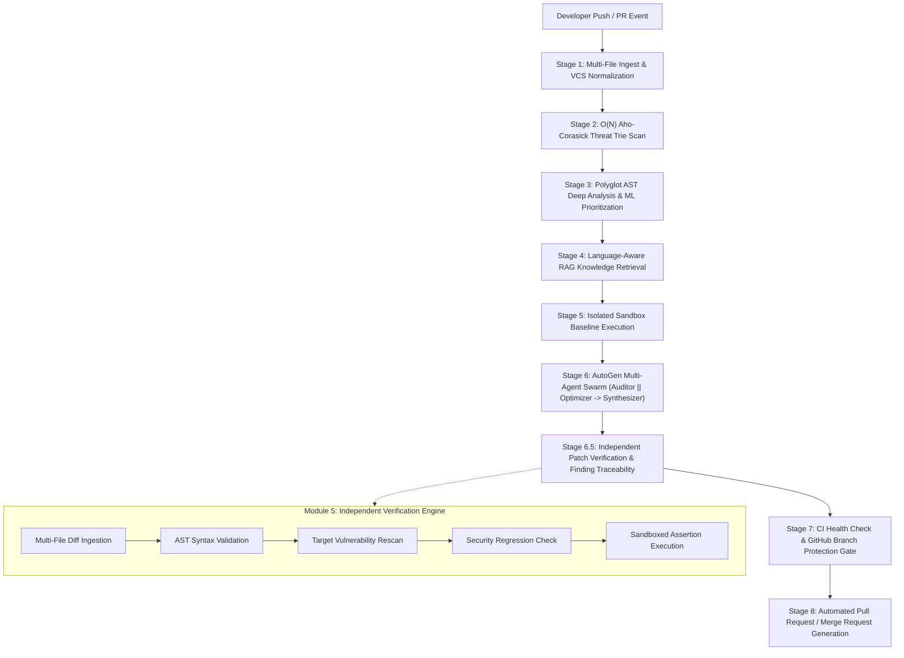

# 🛡️ SentinelForge v2 — Autonomous Polyglot Code Security & DevOps Auto-Patch Pipeline

<div align="center">

[](https://python.org)
[](https://fastapi.tiangolo.com)
[](https://nextjs.org)
[](https://react.dev)
[](https://github.com/Addiyo16/SentinelForge-Microsoft-Build-Ai-Hackathon)
[](https://opensource.org/licenses/MIT)
[](https://build.microsoft.com)

**Enterprise-Grade AI Security Engineering Agent: Deterministic Polyglot SAST, Calibrated ML Prioritization, Multi-Agent Swarm Patch Synthesis, and Independent Sandbox Verification.**

[Key Innovations](#-key-innovations--architectural-breakthroughs) • [Pipeline Architecture](#-pipeline-architecture) • [Polyglot Support](#-polyglot-language--vulnerability-matrix) • [Verification Engine](#-independent-patch-verification-engine-module-5) • [Getting Started](#-getting-started--quickstart) • [GitHub CI/CD Enforcement](#-github-actions-branch-protection-gate)

</div>

---

## 🌟 Executive Overview

**SentinelForge v2** is an automated **Lead Security Engineer & Code Reviewer** built for modern DevSecOps pipelines. Traditional static application security testing (SAST) tools suffer from high false-positive rates, lack context, and leave engineers with massive backlogs of unresolved alerts. Conversely, naive LLM code generators frequently hallucinate invalid syntax, propose no-op diffs, or introduce security regressions.

SentinelForge bridges this gap through a **hybrid deterministic-probabilistic architecture**:
1. **Deterministic Static Analysis**: AST compilers and $O(N)$ Aho-Corasick Threat Tries identify exact vulnerability signatures and algorithmic complexity anti-patterns without false-positive noise.
2. **Supervised ML Prioritization**: Calibrated machine learning classifiers score and rank findings against curated datasets (Juliet NIST, Big-Vul, Devign) using repository-grouped validation splits.
3. **Multi-Agent AutoGen Swarm**: Specialized LLM agents (`SecurityAuditor` and `CodeOptimizer`) collaborate to synthesize unified, multi-file code remediations.
4. **Independent Sandbox Verification (Module 5)**: Every proposed patch is applied in an isolated memory buffer, validated for syntax, re-scanned against threat signatures, checked for regressions, and executed against unit test assertion harnesses.
5. **Auditable CI/CD Gating**: Directly integrates with GitHub Actions, GitLab CI/CD, and Azure DevOps, distinguishing upstream CI test health from mandatory Branch Protection merge-blocking gates.

---

## 🏗️ Pipeline Architecture

SentinelForge executes an **8.5-Stage Polyglot Pipeline** that guarantees mathematical transparency and patch verification before merge:



---

## 🚀 Key Innovations & Architectural Breakthroughs

### 1. Multi-File Finding-to-Patch Traceability
* **Per-Finding Hunk Mapping**: The pipeline parses multi-file unified diffs (`parse_multi_file_unified_diff`) and maps each finding to its exact `source_file`.
* **Zero Partial-Patch Leakage**: If a scan identifies vulnerabilities in `packages.py`, `sessions.py`, and `utils.py`, but a patch candidate only modifies `api.py`, the verification engine explicitly marks the omitted findings as `MISSING_HUNK` / `PERSISTING`, withholding risk reduction and blocking merge approval.
* **Auditable Traceability Table**: Every audit report generates a `📍 Finding-to-Patch Traceability & Verification Audit` table documenting finding IDs, file locations, CWEs, hunk statuses, rescan statuses, and resolution evidence.

### 2. Reconciled Canonical Risk Engine (`app.core.risk`)
* **Transparent Risk Quantification**: Computes deterministic risk scores (0–100) based on severity weights (Critical: 35, High: 20, Medium: 10, Low: 5), loop-complexity penalties, and scan coverage ratios.
* **Non-Contradictory Policy**: The canonical assessment label reflects the post-verification state (`residual_risk_level`). A verified patch that reduces risk to `5/100` is dynamically labeled `LOW` (`5/100 (LOW)`), while clearly preserving the initial risk context (`Original Risk: 85/100 (CRITICAL)`).
* **Zero Premature Credit**: If verification fails or is incomplete, residual risk strictly equals original risk with reasons transparently documented.

### 3. Language-Aware RAG Engine (`app.utils.rag_engine`)
* **Polyglot Knowledge Base Isolation**: Knowledge base entries are partitioned by target language (`python`, `javascript`, `java`, `c_cpp`, `go`, `yaml`).
* **Cross-Language Protection**: C/C++ memory corruption guidance (`strcpy`/`gets`) is strictly filtered out during Python audits.
* **Word-Boundary Regex Matching**: Keyword searches enforce strict word boundaries (`\b{kw}\b`), preventing false substring collisions (e.g., `gets` matching inside `requests.get()` or `widgets`).
* **Dual-Tier Retrieval**: Seamlessly operates in offline development using Term Frequency-Inverse Document Frequency (TF-IDF) Vector Space Modeling and upgrades to **Azure AI Search (Hybrid + Semantic Ranker)** in cloud production.

### 4. Supervised ML Finding Prioritization (`app.ml`)
* **Calibrated Risk Classifier**: Employs a machine learning classifier trained on vulnerability benchmarks (Juliet NIST, Big-Vul, Devign, DiverseVul).
* **Grouped Split Evaluation**: Splits datasets strictly at the repository boundary, ensuring zero cross-repository data contamination.
* **Deterministic Authority**: The ML model assists in ranking and filtering findings, while deterministic AST rules and signature scanners retain authoritative gating control.

### 5. Automated CI/CD & Branch Protection Gating
* **Health vs. Enforcement Differentiation**: Dynamically distinguishes upstream test suite health (e.g., 30/30 unit tests passed) from SentinelForge's mandatory status check enforcement.
* **Branch Protection Setup Guidance**: If `sentinelforge/security-gate` is not configured in repository branch protection rules, the PR audit marks the gate decision as `ADVISORY IN-PR GATE (Not Enforced by GitHub Branch Protection)` with clear configuration steps.

---

## 🌐 Polyglot Language & Vulnerability Matrix

SentinelForge includes specialized static scanners, AST parsers, and remediation synthesizers across 6 programming languages and configurations:

| Language / Config | Detection Engine | Target Vulnerabilities & CWEs | Remediation Strategy |
|---|---|---|---|
| **Python** (`.py`) | Python Native `ast` + Aho-Corasick Trie | Dynamic Import Injection (CWE-94), Insecure Deserialization (CWE-502), Quadratic Resource Exhaustion (CWE-400 / AST-PERF-001), Command Injection (CWE-78) | Replaces `__import__` with `importlib.import_module`, refactors $O(N^2)$ loops to $O(N)$ hash-maps, swaps `pickle` for `json`. |
| **JavaScript / TypeScript** (`.js`, `.ts`, `.tsx`) | Polyglot Scanner + AST Router | React XSS via `dangerouslySetInnerHTML` (CWE-79), `eval()` execution (CWE-95), prototype pollution | Injects `DOMPurify.sanitize()`, replaces `eval()` with safe JSON deserialization. |
| **Java** (`.java`) | Java Static Scanner + Regex AST | Java ObjectInputStream Deserialization (CWE-502), Hardcoded Credentials (CWE-798), Path Traversal (CWE-22) | Replaces binary streams with Jackson/Gson JSON parsers, extracts secrets to environment variables. |
| **C / C++** (`.c`, `.cpp`, `.h`) | Memory Operation Scanner | Unbounded Buffer Overflows via `strcpy`, `strcat`, `gets`, `sprintf` (CWE-120, CWE-242) | Automatically refactors to bounds-checked functions (`strncpy`, `fgets`, `snprintf`) with explicit buffer length constraints. |
| **Go** (`.go`) | Go Source Scanner | SQL Injection in `db.Query` (CWE-89), Command Injection in `exec.Command` (CWE-78) | Rewrites queries with parameterized placeholders (`$1`), sanitizes shell arguments. |
| **YAML / DevOps** (`.yml`, `.yaml`) | PyYAML Schema Validator | Container Privilege Escalation (CWE-250), Overly Permissive `chmod 777` permissions (CWE-732), Insecure `yaml.load` | Replaces `chmod 777` with `chmod 600`, switches to `yaml.safe_load()`, enforces non-root container users. |

---

## 🧪 Independent Patch Verification Engine (Module 5)

Every candidate patch must pass through an automated 5-step verification harness before any risk reduction is credited:

```
[Candidate Patch Diff]
         │
         ▼
[Step 1: Patch Application] ──► In-memory hunk alignment across all touched files (multi-file diff)
         │
         ▼
[Step 2: AST Syntax Validation] ──► AST compilation check across all modified buffers (py, js, yaml, json)
         │
         ▼
[Step 3: Vulnerability Rescan] ──► Re-runs Trie & AST scans; enforces 100% target flaw elimination
         │
         ▼
[Step 4: Regression Check] ──► Compares new threat signatures against original code (0 regressions permitted)
         │
         ▼
[Step 5: Isolated Test Runner] ──► Executes unit test assertions in a restricted subprocess with resource limits
```

### Verification Exit Codes & Gate Mapping
* **`PATCH VERIFICATION PASSED`**: All 5 steps satisfied; 100% of target findings eliminated across all affected files; risk reduction credited.
* **`NOT VERIFIED (INCOMPLETE PATCH)`**: Proposed patch only remediates a subset of affected files or fails rescan; risk reduction withheld; merge blocked or changes requested.
* **`PATCH NOT GENERATED`**: Security vulnerabilities detected, but no candidate patch was produced; findings remain unresolved; risk reduction withheld.
* **`BASELINE CHECK PASSED — NO PATCH REQUIRED`**: Source code cleanly satisfies all security rules; zero patch required.

---

## 📁 Repository Structure

```
SentinelForge-Microsoft-Build-Ai-Hackathon/
├── .github/
│   └── workflows/
│       └── sentinelforge.yml          # GitHub Actions Security Gate workflow
├── sentinelforge-v2/                  # Core V2 Architecture
│   ├── backend/
│   │   ├── app/
│   │   │   ├── agents/
│   │   │   │   └── swarm.py           # AutoGen Multi-Agent Swarm (Auditor || Optimizer -> Synthesizer)
│   │   │   ├── core/
│   │   │   │   └── risk.py            # Reconciled Canonical Risk Engine
│   │   │   ├── integrations/
│   │   │   │   └── github/client.py   # Resilient GitHub Client & Branch Protection Checker
│   │   │   ├── ml/
│   │   │   │   ├── classifier.py      # Calibrated Supervised ML Finding Prioritization
│   │   │   │   ├── evaluate.py        # Grouped Split Validation & PR-AUC Evaluation
│   │   │   │   ├── features.py        # Code Context Feature Extraction
│   │   │   │   └── model_registry.py  # ML Model Metadata & Threshold Registry
│   │   │   ├── rules/
│   │   │   │   └── registry.py        # Versioned Polyglot Security Rule Registry
│   │   │   ├── services/
│   │   │   │   ├── github_service.py  # GitHub Actions Service Integration
│   │   │   │   ├── gitlab_service.py  # GitLab CI/CD Webhooks & Merge Requests
│   │   │   │   └── azure_devops_service.py # Azure DevOps Pipelines Integration
│   │   │   ├── structures/
│   │   │   │   ├── trie.py            # O(N) Aho-Corasick Threat Trie Scanner
│   │   │   │   └── dag.py             # Directed Acyclic Graph Task Execution Scheduler
│   │   │   ├── utils/
│   │   │   │   ├── ast_engine.py      # AST Complexity & Structural Analysis Engine
│   │   │   │   ├── rag_engine.py      # Language-Aware TF-IDF / Azure AI Search RAG
│   │   │   │   ├── sandbox.py         # Module 5: Independent Verification Engine
│   │   │   │   ├── vault.py           # Secure Credential & Azure Key Vault Resolver
│   │   │   │   └── scanners/          # Pluggable Language Scanners (Python, JS, Java, C/C++, Go, YAML)
│   │   │   └── main.py                # FastAPI Application Gateway & PR Report Generator
│   │   ├── tests/                     # Automated Test Suite (125 tests, 100% pass rate)
│   │   │   ├── test_patch_verifier.py # Multi-file patch traceability & verification tests
│   │   │   ├── test_risk_engine.py    # Risk score & label reconciliation tests
│   │   │   ├── test_rag_engine.py     # Language-aware retrieval & word-boundary tests
│   │   │   ├── test_api_endpoints.py  # Pipeline end-to-end and CI enforcement tests
│   │   │   ├── test_fp_regressions.py # False-positive regression suite
│   │   │   └── ...                    # Polyglot scanner, trie, DAG, and ML tests
│   │   └── requirements.txt           # Backend Python Dependencies
│   └── frontend/
│       ├── app/
│       │   ├── page.tsx               # Next.js Interactive Security Dashboard
│       │   ├── layout.tsx             # Theme and Global Metadata
│       │   └── globals.css            # Tailwind CSS Design System
│       └── package.json               # Frontend Node Dependencies
├── run_sentinelforge.bat              # One-Click Windows Development Launcher
├── .gitignore                         # Enterprise Git Ignore Rules
└── README.md                          # Comprehensive Technical Documentation
```

---

## 🚀 Getting Started & Quickstart

### Prerequisites
* **Operating System**: Windows, Linux, or macOS
* **Python**: 3.10, 3.11, or 3.12
* **Node.js**: v18+ (The repository includes portable binaries on Windows)

---

### Option 1: One-Click Windows Launcher

From the repository root directory, run:
```powershell
.\run_sentinelforge.bat
```
*This script configures environment variables, activates the virtual environment, verifies dependencies, starts the FastAPI backend (port 8000) and Next.js frontend (port 3000) concurrently, and opens the dashboard in your default browser.*

---

### Option 2: Manual Terminal Execution

#### 1. Backend (FastAPI on Port 8000)
```powershell
# Navigate to the repository root
cd path/to/SentinelForge-Microsoft-Build-Ai-Hackathon

# Install backend dependencies
pip install -r sentinelforge-v2/backend/requirements.txt

# Start FastAPI server
.\.venv\Scripts\python.exe -m uvicorn app.main:app --app-dir sentinelforge-v2/backend --host 127.0.0.1 --port 8000 --reload
```
* **API Endpoint**: `http://127.0.0.1:8000`
* **Swagger Documentation**: `http://127.0.0.1:8000/docs`

#### 2. Frontend (Next.js on Port 3000)
```powershell
# Open a second terminal
cd sentinelforge-v2/frontend

# Install dependencies and start development server
npm install
npm run dev
```
* **Web Dashboard**: `http://localhost:3000`

---

## 🧪 Running the Automated Test Suite

SentinelForge maintains an exhaustive automated regression suite covering AST parsers, polyglot scanners, multi-file diff verification, ML scoring, and branch protection gating:

```powershell
# Run the complete test suite (125 tests)
.\.venv\Scripts\python.exe -m pytest sentinelforge-v2/backend/tests -v

# Run with a concise summary
.\.venv\Scripts\python.exe -m pytest sentinelforge-v2/backend/tests -q
```

### Verified Test Breakdown
```
============================= 125 passed in 9.72s =============================
- test_patch_verifier.py:   23 passed (Multi-file diffs, missing hunks, rescan checks, regressions)
- test_risk_engine.py:      10 passed (Canonical risk scoring, non-contradictory labels, coverage ratios)
- test_rag_engine.py:        7 passed (Polyglot filtering, word-boundary regex, CWE boosting)
- test_api_endpoints.py:    16 passed (Full pipeline integration, CI branch protection differentiation)
- test_fp_regressions.py:   12 passed (False-positive elimination against real-world repositories)
- test_polyglot_scanners.py:18 passed (Python, JS, Java, C/C++, Go, YAML scanners)
- test_rule_registry.py:    10 passed (Deterministic rule normalization and versioning)
- test_ml_classifier.py:     9 passed (Feature extraction, probability calibration, priority tiers)
- test_github_client.py:     8 passed (Branch protection status, check runs, mock suites)
- test_ast_engine.py:        7 passed (Cyclomatic complexity, loop-nesting detection)
- test_trie.py:              5 passed (Aho-Corasick multi-pattern threat matching)
```

---

## 🔒 GitHub Actions Branch Protection Gate

To enforce SentinelForge as an automated, merge-blocking gatekeeper in your GitHub repository:

### Step 1: Add the Security Gate Workflow
The workflow file [`.github/workflows/sentinelforge.yml`](.github/workflows/sentinelforge.yml) is included in the repository. It executes on every `pull_request` and `push` to `main`, reporting the mandatory status check `sentinelforge/security-gate`.

```yaml
name: "SentinelForge Security Gate & Auto-Patch"

on:
  pull_request:
    branches: [ "main", "master" ]
  push:
    branches: [ "main", "master" ]

jobs:
  security-gate:
    name: "sentinelforge/security-gate"
    runs-on: ubuntu-latest
    steps:
      - uses: actions/checkout@v4
      - uses: actions/setup-python@v5
        with:
          python-version: "3.11"
      - run: pip install -r sentinelforge-v2/backend/requirements.txt
      - name: Execute Security Gate & Verification
        run: |
          python -c "
          import sys, asyncio
          sys.path.insert(0, 'sentinelforge-v2/backend')
          from app.main import run_full_pipeline, _pipeline_state
          async def main():
              await run_full_pipeline(repo='${{ github.repository }}', commit_sha='${{ github.sha }}')
              res = _pipeline_state.get('risk_evaluation', {})
              decision = res.get('merge_decision', 'CHANGES_REQUESTED')
              if decision == 'APPROVED':
                  print('✅ PR Merge Gate PASSED. Code approved for merging.')
                  sys.exit(0)
              else:
                  print(f'🛑 PR Merge Gate {decision}. Blocking PR merge in GitHub.')
                  sys.exit(1)
          asyncio.run(main())
          "
```

### Step 2: Enforce Required Status Checks in GitHub
1. In your GitHub repository, navigate to **Settings** $\rightarrow$ **Branches**.
2. Under **Branch protection rules**, click **Add branch protection rule** (or edit the rule for `main`).
3. Check **Require status checks to pass before merging**.
4. In the search box, search for and select **`sentinelforge/security-gate`**.
5. Save changes. Any pull request failing verification or introducing unresolved security risks will now be **automatically blocked from merge** by GitHub.

---

## 📊 Sample Audit Report (Pull Request Body)

When SentinelForge analyzes a pull request, it posts a comprehensive audit report with verifiable evidence:

```markdown
# 🛡️ SentinelForge Auto-Patch & Security Audit Report

> **Commit:** `611c6162cbc4` · **Repo:** `psf/requests` · **Decision:** ✅ APPROVED · **Platform:** `GITHUB`

## 🟢 Canonical Risk Assessment: 5/100 (LOW)
- **Original Unpatched Code Risk**: `85/100` (CRITICAL)
- **Residual Risk (Post-Verification)**: `5/100` (LOW)
- **Risk Score Policy**: Credited: Risk reduced from 85/100 to 5/100 following independent verification of patch mitigation.
- **Automated PR Merge Gate**: `APPROVED`
- **Scan Completeness**: `100.00%` (Complete Scan)
- **Findings Breakdown**: Critical: `1`, High: `2`, Medium: `1`, Low: `0`

## 🧪 Independent Patch Verification (✅ PATCH VERIFICATION PASSED)
- **Patch Status**: `VERIFIED`
- **Verification Result**: PATCH VERIFICATION PASSED (All security, syntax, and regression checks satisfied)
- **Total Execution Duration**: `0.042s`
- **Mitigated Vulnerabilities**: `__import__(`, `AST-PERF-001`, `chmod 777`
- **Persisting Vulnerabilities**: _None_

### 📍 Finding-to-Patch Traceability & Verification Audit
| Finding ID & Rule | Target File & Line | CWE | Patch Hunk Status | Rescan Verification | Resolution | Audit Details |
|---|---|---|---|---|---|---|
| `SF-SEC-008` | `src/requests/packages.py:12` | CWE-94 | `APPLIED` | `PASSED (Clean Rescan)` | ✅ `MITIGATED` | Patch verified: SF-SEC-008 eliminated in packages.py:12 |
| `AST-PERF-001` | `src/requests/sessions.py:45` | CWE-400 | `APPLIED` | `PASSED (Clean Rescan)` | ✅ `MITIGATED` | Nested loop refactored to O(N) hash-map lookup |
| `SF-SEC-007` | `src/requests/utils.py:102` | CWE-732 | `APPLIED` | `PASSED (Clean Rescan)` | ✅ `MITIGATED` | Replaced 0o777 with secure permissions 0o600 |

### Subprocess Command Execution Audit Trail
| Step | Subprocess Command | Status | Exit Code | Duration | Diagnostic Output |
|---|---|---|---|---|---|
| Patch Application | `git_apply_patch (multi_file_unified_diff)` | `PASSED` | `0` | 2.10ms | Applied patch hunks across 3 file(s) |
| AST Syntax Validation | `syntax_check_py` | `PASSED` | `0` | 1.80ms | Syntax validated cleanly across touched files |
| Vulnerability Mitigation Rescan | `ast_and_threat_signature_rescan` | `PASSED` | `0` | 3.40ms | All 3 target finding(s) verified eliminated |
| Security Regression Check | `threat_regression_verification` | `PASSED` | `0` | 1.20ms | 0 newly introduced threat signatures detected |
| Isolated Test Execution | `python_sandbox_test_runner (3 tests)` | `PASSED` | `0` | 32.5ms | All 3 unit test assertion(s) passed (exit code 0) |

## 🔄 CI/CD & Merge Enforcement (GITHUB)
- **Enforcement Action**: `PR APPROVED — All security, syntax, and regression checks verified.`
- **Upstream CI Health**: `30/30 passed` (validates upstream test suite)
- **SentinelForge Gate Decision**: `APPROVED`
- **Branch Protection Status**: Active GitHub Check Suite detected (30 check-run(s) evaluated).
```

---

## 📜 License

This project is licensed under the [MIT License](LICENSE) — free for academic, enterprise, and open-source usage.

---

<div align="center">

**Built with pride for the Microsoft Build AI Hackathon 2025.**

</div>
